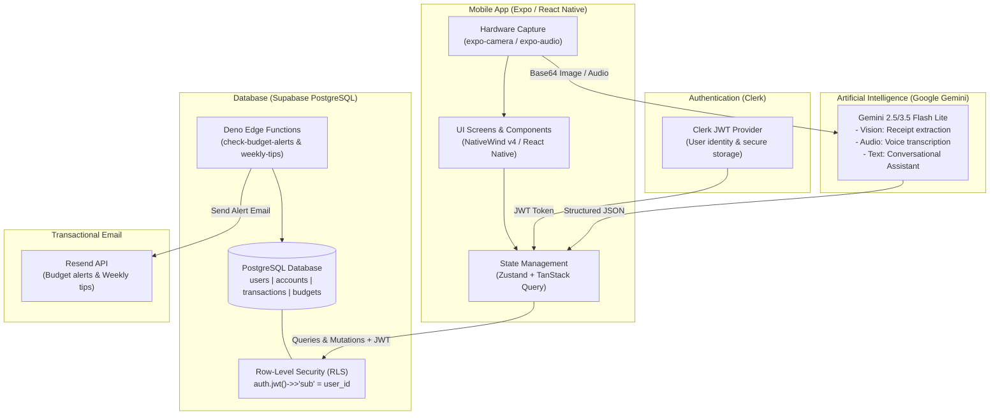
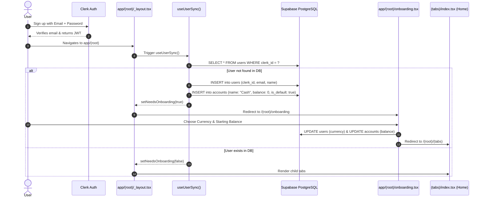
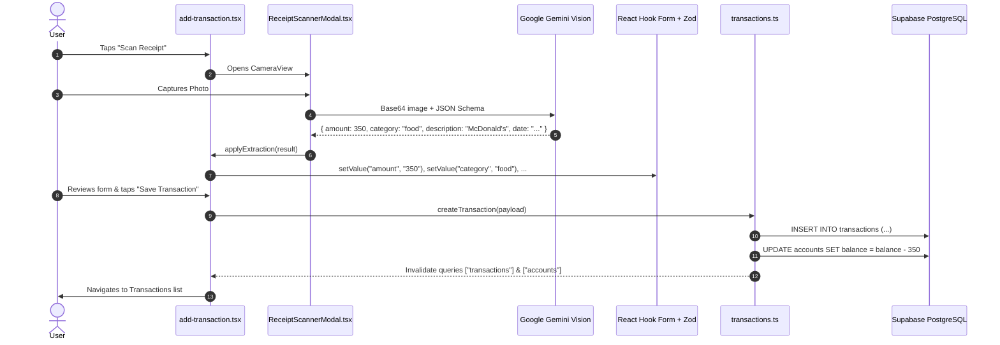

# 🧭 BudgetCo Codebase Walkthrough & Navigation Guide

> **Welcome to BudgetCo!**  
> If you are new to this repository and don't know where to start, **this document is your sequential reading roadmap**. It walks you through the codebase in the exact order designed to build your mental model layer by layer — from foundational contracts and data stores up to multi-modal AI pipelines and user interfaces.

---

## 📑 Table of Contents

1. [The 30,000-Foot Architecture](#1-the-30000-foot-architecture)
2. [Sequential Reading Order (10-Step Roadmap)](#2-sequential-reading-order-10-step-roadmap)
   - [Step 1: Configuration & Environment Setup](#step-1-configuration--environment-setup)
   - [Step 2: Domain Types, Constants & Zod Schemas](#step-2-domain-types-constants--zod-schemas)
   - [Step 3: Database & Auth Infrastructure](#step-3-database--auth-infrastructure)
   - [Step 4: Data Services & TanStack Query Layer](#step-4-data-services--tanstack-query-layer)
   - [Step 5: Client Store & Auth Synchronization](#step-5-client-store--auth-synchronization)
   - [Step 6: Navigation Architecture & Route Guards](#step-6-navigation-architecture--route-guards)
   - [Step 7: The Five Core Tab Screens](#step-7-the-five-core-tab-screens)
   - [Step 8: Reusable UI Components & Modals](#step-8-reusable-ui-components--modals)
   - [Step 9: Multi-Modal AI Engine (Gemini)](#step-9-multi-modal-ai-engine-gemini)
   - [Step 10: Serverless Edge Functions & Cron Jobs](#step-10-serverless-edge-functions--cron-jobs)
3. [End-to-End Lifecycle Traces](#3-end-to-end-lifecycle-traces)
   - [Trace A: User Signup, Sync & Onboarding](#trace-a-user-signup-sync--onboarding)
   - [Trace B: Receipt Photo to Saved Transaction](#trace-b-receipt-photo-to-saved-transaction)
   - [Trace C: Voice Entry to Saved Transaction](#trace-c-voice-entry-to-saved-transaction)
   - [Trace D: AI Assistant Spending Query](#trace-d-ai-assistant-spending-query)
4. [Developer Commandments & Conventions](#4-developer-commandments--conventions)
5. [Feature-to-File Quick Reference](#5-feature-to-file-quick-reference)

---

## 1. The 30,000-Foot Architecture

BudgetCo is a modern, cross-platform personal finance tracker built on **React Native (Expo SDK 54)**. It bridges three primary external systems:



### The Core Invariants:
1. **User Identity**: Managed by **Clerk**. Clerk provides user IDs (`user_id = user.id`), profile info, and short-lived JWTs.
2. **Data Storage & RLS**: Managed by **Supabase PostgreSQL**. Every table enforces Row-Level Security where `user_id = auth.jwt()->>'sub'`. The client injects the Clerk JWT on every request.
3. **AI Intelligence**: Powered by **Google Gemini Flash Lite**. Used directly from client services with structured JSON schema responses for optical receipt reading and audio transcription.
4. **Navigation**: Managed by **Expo Router v6** (file-based routing based on React Navigation).

---

## 2. Sequential Reading Order (10-Step Roadmap)

Follow these 10 steps in chronological order to understand how the system is built from the ground up:

```mermaid
flowchart LR
    S1["1. Config & Setup"] --> S2["2. Schemas & Types"]
    S2 --> S3["3. Auth & DB Infra"]
    S3 --> S4["4. Services & Query Layer"]
    S4 --> S5["5. Store & User Sync"]
    S5 --> S6["6. Router Layouts"]
    S6 --> S7["7. Core Tab Screens"]
    S7 --> S8["8. Reusable Components"]
    S8 --> S9["9. Gemini AI Engine"]
    S9 --> S10["10. Edge Functions"]
```



---

### Step 1: Configuration & Environment Setup
Start here to understand dependencies, build configurations, and styling setup.

| Order | File | What to look for |
|:---:|---|---|
| **1.1** | [`package.json`](file:///c:/Users/singl/OneDrive/Desktop/budgetco/package.json) | Notice the versions: `expo ~54.0.37`, `react 19.1.0`, `react-native 0.81.5`, `@clerk/expo`, `@tanstack/react-query`, `nativewind ^4.2.6`. |
| **1.2** | [`app.json`](file:///c:/Users/singl/OneDrive/Desktop/budgetco/app.json) | Expo config, scheme (`budgetco`), camera/microphone permission descriptions, plugin configurations. |
| **1.3** | [`.env`](file:///c:/Users/singl/OneDrive/Desktop/budgetco/.env) | Environment variable definitions: `EXPO_PUBLIC_CLERK_PUBLISHABLE_KEY`, `EXPO_PUBLIC_SUPABASE_URL`, `EXPO_PUBLIC_SUPABASE_KEY`, `EXPO_PUBLIC_GEMINI_API_KEY`. |
| **1.4** | [`tailwind.config.js`](file:///c:/Users/singl/OneDrive/Desktop/budgetco/tailwind.config.js) & [`global.css`](file:///c:/Users/singl/OneDrive/Desktop/budgetco/global.css) | NativeWind preset configuration and CSS design tokens (charcoal `#1A1D26`, light body `#F8F7F2`, border `#E8E6DF`). |
| **1.5** | [`metro.config.js`](file:///c:/Users/singl/OneDrive/Desktop/budgetco/metro.config.js) | NativeWind `withNativeWind` Metro bundler wrapper pointing to `global.css`. |

---

### Step 2: Domain Types, Constants & Zod Schemas
Before touching UI or API code, read the data contracts. Everything in the app respects these schemas.

| Order | File | Purpose |
|:---:|---|---|
| **2.1** | [`types/transaction.ts`](file:///c:/Users/singl/OneDrive/Desktop/budgetco/types/transaction.ts)<br>[`types/account.ts`](file:///c:/Users/singl/OneDrive/Desktop/budgetco/types/account.ts)<br>[`types/budget.ts`](file:///c:/Users/singl/OneDrive/Desktop/budgetco/types/budget.ts) | Canonical TypeScript models matching Supabase tables: `Transaction`, `Account`, `Budget`. |
| **2.2** | [`constants/categories.ts`](file:///c:/Users/singl/OneDrive/Desktop/budgetco/constants/categories.ts) | Strict category lists (`EXPENSE_CATEGORIES`: Food, Shopping, Transport, Bills, etc. & `INCOME_CATEGORIES`: Salary, Freelance, Investment, etc.) with icons and colors. |
| **2.3** | [`constants/theme.ts`](file:///c:/Users/singl/OneDrive/Desktop/budgetco/constants/theme.ts) | UI color palettes, gradients (`AI_GRADIENT`, `RECORDING_GRADIENT`), and status colors. |
| **2.4** | [`lib/schemas/transaction.ts`](file:///c:/Users/singl/OneDrive/Desktop/budgetco/lib/schemas/transaction.ts) | Zod validation schema for creating a transaction (`amount` regex, `category`, `accountId`, `date`). |
| **2.5** | [`lib/schemas/onboarding.ts`](file:///c:/Users/singl/OneDrive/Desktop/budgetco/lib/schemas/onboarding.ts) | Zod schema validating initial starting balance during user onboarding. |
| **2.6** | [`lib/schemas/auth.ts`](file:///c:/Users/singl/OneDrive/Desktop/budgetco/lib/schemas/auth.ts) | Sign-in and sign-up form validation schemas. |

---

### Step 3: Database & Auth Infrastructure
Understand how authenticated client sessions communicate securely with Supabase.

| Order | File | Key Architecture Points |
|:---:|---|---|
| **3.1** | [`lib/supabase.ts`](file:///c:/Users/singl/OneDrive/Desktop/budgetco/lib/supabase.ts) | Custom Supabase client factory. Notice how `createClient` accepts an optional token fetcher (`getClerkToken`) to inject Clerk's JWT into the HTTP `Authorization: Bearer <JWT>` header. |
| **3.2** | [`hooks/useSupabase.ts`](file:///c:/Users/singl/OneDrive/Desktop/budgetco/hooks/useSupabase.ts) | React hook combining Clerk's `useAuth().getToken({ template: "supabase" })` with `getSupabaseClient(fetchToken)`. **Every service query passes through this authenticated client.** |

---

### Step 4: Data Services & TanStack Query Layer
See how raw database operations are encapsulated into clean services and wrapped in reactive TanStack Query hooks.

| Order | File | What it does |
|:---:|---|---|
| **4.1** | [`lib/services/transactions.ts`](file:///c:/Users/singl/OneDrive/Desktop/budgetco/lib/services/transactions.ts) | `getTransactions()`, `createTransaction()`, `deleteTransaction()`. **Critical note**: Notice how `createTransaction` and `deleteTransaction` perform atomic account balance adjustments sequentially (`account.balance +/- amount`). |
| **4.2** | [`lib/services/accounts.ts`](file:///c:/Users/singl/OneDrive/Desktop/budgetco/lib/services/accounts.ts) | `getAccounts()`, `createAccount()`, `updateAccount()`, `deleteAccount()`, `setDefaultAccount()`. |
| **4.3** | [`lib/services/budgets.ts`](file:///c:/Users/singl/OneDrive/Desktop/budgetco/lib/services/budgets.ts) | `getCurrentBudget()`, `upsertBudget()`. Handles monthly budget limits for the active month. |
| **4.4** | [`lib/query/keys.ts`](file:///c:/Users/singl/OneDrive/Desktop/budgetco/lib/query/keys.ts) & [`lib/query/client.ts`](file:///c:/Users/singl/OneDrive/Desktop/budgetco/lib/query/client.ts) | Central query key factories (`["transactions"]`, `["accounts"]`, `["budgets"]`) and `QueryClient` cache configuration. |
| **4.5** | [`hooks/queries/`](file:///c:/Users/singl/OneDrive/Desktop/budgetco/hooks/queries/) | React Query hooks (`useTransactionsQuery`, `useAccountsQuery`, `useBudgetQuery`). |
| **4.6** | [`hooks/mutations/`](file:///c:/Users/singl/OneDrive/Desktop/budgetco/hooks/mutations/) | Mutation hooks (`useTransactionMutations`, `useAccountMutations`, `useBudgetMutations`) that auto-invalidate related caches upon success. |

---

### Step 5: Client Store & Auth Synchronization
Understand how user session state is coordinated between Clerk, Zustand, and Supabase.

| Order | File | Description |
|:---:|---|---|
| **5.1** | [`store/userStore.ts`](file:///c:/Users/singl/OneDrive/Desktop/budgetco/store/userStore.ts) | Client-side Zustand store managing `currency` (e.g. `"USD"`, `"INR"`) and the `needsOnboarding` boolean flag. |
| **5.2** | [`hooks/useUserSync.ts`](file:///c:/Users/singl/OneDrive/Desktop/budgetco/hooks/useUserSync.ts) | **The Bridge Hook**: Runs whenever a Clerk user logs in. Checks if the user exists in the Supabase `users` table; if not, inserts a new user record, automatically seeds a default `"Cash"` account with `0` balance, and populates `userStore`. |

---

### Step 6: Navigation Architecture & Route Guards
BudgetCo uses Expo Router v6 (file-system based routing). The root wraps the entire app in native stack and auth providers.

```
app/
├── _layout.tsx           ← Master wrapper (ClerkProvider, ClerkLoaded, Stack)
├── index.tsx             ← Traffic controller (checks auth -> redirects to /sign-in or /(root)/(tabs))
├── (auth)/               ← Authentication Route Group
│   ├── _layout.tsx       ← Stack for unauthenticated users
│   ├── sign-in.tsx       ← Email/Password login + MFA verification
│   └── sign-up.tsx       ← Registration with email code confirmation
└── (root)/               ← Protected Route Group
    ├── _layout.tsx       ← Auth guard + useUserSync + Onboarding gatekeeper
    ├── onboarding.tsx    ← First-time setup (currency + initial balance)
    └── (tabs)/           ← The 5 Main App Tabs
        ├── _layout.tsx   ← Bottom tab bar controller
        ├── index.tsx     ← Tab 1: Dashboard
        ├── transactions.tsx ← Tab 2: Transaction History & Bar Chart
        ├── add-transaction.tsx ← Tab 3: Receipt Scan / Voice / Manual Add
        ├── assistant.tsx ← Tab 4: AI Financial Chat Assistant
        └── profile.tsx   ← Tab 5: Account & Settings Management
```

| Order | File | Navigation Logic |
|:---:|---|---|
| **6.1** | [`app/_layout.tsx`](file:///c:/Users/singl/OneDrive/Desktop/budgetco/app/_layout.tsx) | Mounts `GestureHandlerRootView`, `QueryClientProvider`, `ClerkProvider`, `<ClerkLoaded>`, and the root `<Stack screenOptions={{ headerShown: false }}>`. |
| **6.2** | [`app/index.tsx`](file:///c:/Users/singl/OneDrive/Desktop/budgetco/app/index.tsx) | Checks `useAuth()`. If not signed in $\rightarrow$ redirects to `/sign-in`. If signed in $\rightarrow$ redirects to `/(root)/(tabs)`. |
| **6.3** | [`app/(auth)/_layout.tsx`](file:///c:/Users/singl/OneDrive/Desktop/budgetco/app/(auth)/_layout.tsx)<br>[`app/(auth)/sign-in.tsx`](file:///c:/Users/singl/OneDrive/Desktop/budgetco/app/(auth)/sign-in.tsx)<br>[`app/(auth)/sign-up.tsx`](file:///c:/Users/singl/OneDrive/Desktop/budgetco/app/(auth)/sign-up.tsx) | Handles authentication flows using Clerk's SDK with email verification modals. |
| **6.4** | [`app/(root)/_layout.tsx`](file:///c:/Users/singl/OneDrive/Desktop/budgetco/app/(root)/_layout.tsx) | Executes `useUserSync()`. If `needsOnboarding === true` and user isn't on `/onboarding`, redirects to `/(root)/onboarding`. Otherwise renders child `<Slot />`. |
| **6.5** | [`app/(root)/onboarding.tsx`](file:///c:/Users/singl/OneDrive/Desktop/budgetco/app/(root)/onboarding.tsx) | Prompts for currency and starting balance, updates Supabase default account balance, sets `needsOnboarding = false`, and replaces route with `/(root)/(tabs)`. |
| **6.6** | [`app/(root)/(tabs)/_layout.tsx`](file:///c:/Users/singl/OneDrive/Desktop/budgetco/app/(root)/(tabs)/_layout.tsx) | Defines the bottom `<Tabs>` navigator with custom tab bar height, padding, icons, and labels. |

---

### Step 7: The Five Core Tab Screens
Read the tab screens in the order a typical user navigates them.

| Order | Screen | File | Key Features & Implementation |
|:---:|---|---|---|
| **7.1** | **Home / Dashboard** | [`app/(root)/(tabs)/index.tsx`](file:///c:/Users/singl/OneDrive/Desktop/budgetco/app/(root)/(tabs)/index.tsx) | - Dark charcoal hero header with total balance & income/expense badges.<br>- Quick action shortcuts (AI Receipt Scan, Voice Log, Add Manually).<br>- Monthly budget card with progress bar.<br>- Donut pie chart for category expense breakdown.<br>- Recent transactions list. |
| **7.2** | **Transactions Explorer** | [`app/(root)/(tabs)/transactions.tsx`](file:///c:/Users/singl/OneDrive/Desktop/budgetco/app/(root)/(tabs)/transactions.tsx) | - Full transaction list with swipe-to-refresh & delete.<br>- Grouped daily activity bar chart (Income vs Expense).<br>- Type filter pills (All, Income, Expense) & horizontal account pills.<br>- Real-time free-text search.<br>- One-tap CSV export via `exportTransactionsToCsv()`.<br>- Floating Action Button (`+`) elevated above the tab bar. |
| **7.3** | **Add Transaction** | [`app/(root)/(tabs)/add-transaction.tsx`](file:///c:/Users/singl/OneDrive/Desktop/budgetco/app/(root)/(tabs)/add-transaction.tsx) | - Multi-modal entry: AI receipt scanner modal, voice recorder modal, or manual inputs.<br>- Segmented Expense/Income toggle.<br>- Prominent amount input with currency prefix.<br>- Category selector via `PillGroup`.<br>- Account selector via `PillGroup`.<br>- Date picker modal.<br>- Validation via React Hook Form + Zod. |
| **7.4** | **AI Assistant** | [`app/(root)/(tabs)/assistant.tsx`](file:///c:/Users/singl/OneDrive/Desktop/budgetco/app/(root)/(tabs)/assistant.tsx) | - Conversational finance chat powered by Gemini.<br>- Injects 30-day transaction history + monthly budget into context.<br>- **Dynamic Keyboard Avoidance**: uses `Keyboard` listeners to keep input bar resting above tab bar when closed, and immediately above the keyboard when typing.<br>- Auto-scrolling message list with custom robot pill styling. |
| **7.5** | **Profile & Settings** | [`app/(root)/(tabs)/profile.tsx`](file:///c:/Users/singl/OneDrive/Desktop/budgetco/app/(root)/(tabs)/profile.tsx) | - User avatar with image picker upload to Clerk.<br>- Linked account management (Cash, Bank, Card, Savings).<br>- Add/Edit account modal & default account switcher.<br>- Currency selector modal (150+ currencies).<br>- Biometric lock toggle.<br>- Sign out action. |

---

### Step 8: Reusable UI Components & Modals
These building blocks are shared across screens.

| Component | File | Responsibilities |
|---|---|---|
| **`TransactionRow`** | [`components/TransactionRow.tsx`](file:///c:/Users/singl/OneDrive/Desktop/budgetco/components/TransactionRow.tsx) | Renders an individual transaction card with category icon, merchant/description, date, formatted amount, and delete action. |
| **`PillGroup`** | [`components/PillGroup.tsx`](file:///c:/Users/singl/OneDrive/Desktop/budgetco/components/PillGroup.tsx) | Cross-platform horizontal selectable chips (used for categories and accounts). Uses safe inline styles to prevent CSS-interop upgrade warnings. |
| **`AIActionCard`** | [`components/AIActionCard.tsx`](file:///c:/Users/singl/OneDrive/Desktop/budgetco/components/AIActionCard.tsx) | Animated shimmer card (React Native Reanimated) used for AI shortcuts on Dashboard and Add screen. |
| **`CalendarPicker`** | [`components/CalendarPicker.tsx`](file:///c:/Users/singl/OneDrive/Desktop/budgetco/components/CalendarPicker.tsx) | Inline date picker wrapper using `react-native-ui-datepicker`. |
| **`CurrencyPicker`** | [`components/CurrencyPicker.tsx`](file:///c:/Users/singl/OneDrive/Desktop/budgetco/components/CurrencyPicker.tsx) | Full modal list of global currencies with real-time search by country or symbol. |
| **`FormSheetModal`** | [`components/FormSheetModal.tsx`](file:///c:/Users/singl/OneDrive/Desktop/budgetco/components/FormSheetModal.tsx) | Base bottom sheet modal with grab handle indicator, backdrop tap-to-dismiss, and keyboard avoidance. |
| **`AccountModal`** | [`components/AccountModal.tsx`](file:///c:/Users/singl/OneDrive/Desktop/budgetco/components/AccountModal.tsx) | Bottom sheet for creating, editing, and deleting financial accounts. |
| **`BudgetModal`** | [`components/BudgetModal.tsx`](file:///c:/Users/singl/OneDrive/Desktop/budgetco/components/BudgetModal.tsx) | Bottom sheet for setting and adjusting the monthly budget limit. |

---

### Step 9: Multi-Modal AI Engine (Gemini)
This is where the core AI magic happens. BudgetCo utilizes **Google Gemini 3.5 Flash Lite** for zero-friction data capture and conversational insights.

| Module | File | Implementation Details |
|---|---|---|
| **Receipt Scanner Modal** | [`components/ReceiptScannerModal.tsx`](file:///c:/Users/singl/OneDrive/Desktop/budgetco/components/ReceiptScannerModal.tsx) | Uses `expo-camera` (`CameraView`) with custom dashed overlay and photo library picker via `expo-image-picker`. Captures image as base64. |
| **Voice Recorder Modal** | [`components/VoiceRecorderModal.tsx`](file:///c:/Users/singl/OneDrive/Desktop/budgetco/components/VoiceRecorderModal.tsx) | Uses `expo-audio` (`useAudioRecorder`) with animated pulsing rings. Records `.m4a` audio, reads it as base64 using `expo-file-system`. |
| **Multimodal Extractor** | [`lib/services/extractTransaction.ts`](file:///c:/Users/singl/OneDrive/Desktop/budgetco/lib/services/extractTransaction.ts) | - `extractTransactionFromReceipt(base64, mimeType)`: sends base64 image to Gemini with strict JSON schema response requiring `amount`, `category`, `description`, `date`.<br>- `extractTransactionFromVoice(base64, mimeType)`: sends base64 audio to Gemini, transcribing text and extracting structured fields in a single step. |
| **AI Assistant Service** | [`lib/services/assistant.ts`](file:///c:/Users/singl/OneDrive/Desktop/budgetco/lib/services/assistant.ts) | Formats last 30 days of transactions and current budget into a concise context block, sets financial advisor system instructions, and calls Gemini to answer conversational user queries. |

---

### Step 10: Serverless Edge Functions & Cron Jobs
The server-side automation runs on **Supabase Edge Functions** (Deno runtime).

| Function | Path | Trigger & Purpose |
|---|---|---|
| **Budget Alert Checker** | [`supabase/functions/check-budget-alerts/index.ts`](file:///c:/Users/singl/OneDrive/Desktop/budgetco/supabase/functions/check-budget-alerts/index.ts) | **Trigger**: Daily cron schedule.<br>**Logic**: Computes current monthly spending vs budget for each user. When spending crosses 80% or 100%, sends a styled alert email via Resend API and logs the alert to prevent spamming. |
| **Weekly Financial Tips** | [`supabase/functions/weekly-tips/index.ts`](file:///c:/Users/singl/OneDrive/Desktop/budgetco/supabase/functions/weekly-tips/index.ts) | **Trigger**: Weekly cron schedule (every Sunday).<br>**Logic**: Aggregates the user's weekly spending, prompts Gemini to generate 3 actionable, personalized financial tips, and sends an HTML recap email via Resend. |
| **Shared Helpers** | [`supabase/functions/_shared/`](file:///c:/Users/singl/OneDrive/Desktop/budgetco/supabase/functions/_shared/) | Shared Deno utilities: `resend.ts` (email client), `supabaseAdmin.ts` (service role bypass), `emailLayout.ts` (HTML templates). |

---

## 3. End-to-End Lifecycle Traces

To solidify your understanding of how the layers interact, trace these real user flows:

### Trace A: User Signup, Sync & Onboarding


---

### Trace B: Receipt Photo to Saved Transaction


---

### Trace C: Voice Entry to Saved Transaction
1. User taps **Voice Log** on `add-transaction.tsx`.
2. `VoiceRecorderModal.tsx` requests audio permissions and begins recording `.m4a` audio via `expo-audio`.
3. User speaks: *"I paid 1200 for electricity bill yesterday"*.
4. User stops recording. `expo-file-system` reads the file as base64 string.
5. `extractTransactionFromVoice(base64)` sends the audio payload to Gemini 3.5 Flash Lite with an audio prompt and structured extraction schema.
6. Gemini transcribes the audio and extracts:
   ```json
   {
     "amount": 1200,
     "category": "bills",
     "description": "Electricity bill",
     "date": "2026-11-05T00:00:00.000Z",
     "transcript": "I paid 1200 for electricity bill yesterday"
   }
   ```
7. The extracted values are piped into React Hook Form; the modal dismisses with the form pre-filled and ready for confirmation.

---

### Trace D: AI Assistant Spending Query
1. User navigates to **Assistant** tab (`app/(root)/(tabs)/assistant.tsx`).
2. User types: *"How much did I spend on food this month?"*.
3. `assistant.tsx` executes TanStack queries to fetch the user's transactions (last 30 days) and active monthly budget.
4. `askAssistant(prompt, transactions, budget, currency)` compiles a structured prompt containing:
   - System persona: *"You are an AI personal finance assistant for BudgetCo..."*
   - Context: Compact JSON of all transactions (date, amount, category, description).
   - User question: *"How much did I spend on food this month?"*.
5. Gemini generates a conversational, accurate answer based purely on real transaction records.
6. The chat screen auto-scrolls to the bottom with dynamic keyboard avoidance.

---

## 4. Developer Commandments & Conventions

When modifying or extending this codebase, adhere to these architectural rules:

### 1. Navigation & Root Layout Rules
* **Never use `<Slot />` at the root layout without a `<Stack>`**: The root `app/_layout.tsx` must wrap screens in `<Stack screenOptions={{ headerShown: false }}>` so that native `NavigationContainer` context is immediately present on mobile (Expo Go).
* **Always wrap routes in `<ClerkLoaded>`**: Ensures Clerk's session token cache has initialized before any screen attempts to query Supabase or check auth status.

### 2. NativeWind & Styling Guidelines
* **Avoid `active:` pseudo-classes on `TouchableOpacity`**: NativeWind's underlying engine (`react-native-css-interop`) attempts to upgrade `View`/`TouchableOpacity` components to `Pressable` when it detects `:active` classes. In React 19, this triggers warning serialization that inspects React Navigation's Fiber context and crashes. Always use `activeOpacity={0.8}` or standard `style={{ ... }}` for dynamic selection styles.
* **Component-Safe Styles**: For components with dynamic states (like selected pills in `PillGroup.tsx` or segmented toggles), prefer standard React Native `style` objects.

### 3. Database & RLS Access
* **Never bypass RLS on client calls**: Always use `useSupabase()` which passes the Clerk JWT. All tables (`users`, `accounts`, `transactions`, `budgets`) verify `auth.jwt()->>'sub' = user_id`.
* **Sequential Balance Updates**: When creating or deleting transactions, always update the linked account's balance to maintain financial integrity.

### 4. Expo SDK 54 Versioned Documentation
* Per project rules, always refer to the exact versioned documentation at:
  [https://docs.expo.dev/versions/v54.0.0/](https://docs.expo.dev/versions/v54.0.0/)

---

## 5. Feature-to-File Quick Reference

Looking to tweak a specific feature? Use this index to jump straight to the relevant files:

| If you want to modify... | Look at these files: |
|---|---|
| **Receipt Scanner OCR & Fields** | [`lib/services/extractTransaction.ts`](file:///c:/Users/singl/OneDrive/Desktop/budgetco/lib/services/extractTransaction.ts), [`components/ReceiptScannerModal.tsx`](file:///c:/Users/singl/OneDrive/Desktop/budgetco/components/ReceiptScannerModal.tsx) |
| **Voice Logging & Audio Prompts** | [`lib/services/extractTransaction.ts`](file:///c:/Users/singl/OneDrive/Desktop/budgetco/lib/services/extractTransaction.ts), [`components/VoiceRecorderModal.tsx`](file:///c:/Users/singl/OneDrive/Desktop/budgetco/components/VoiceRecorderModal.tsx) |
| **AI Assistant Persona & Context** | [`lib/services/assistant.ts`](file:///c:/Users/singl/OneDrive/Desktop/budgetco/lib/services/assistant.ts), [`app/(root)/(tabs)/assistant.tsx`](file:///c:/Users/singl/OneDrive/Desktop/budgetco/app/(root)/(tabs)/assistant.tsx) |
| **Categories & Category Colors** | [`constants/categories.ts`](file:///c:/Users/singl/OneDrive/Desktop/budgetco/constants/categories.ts) |
| **Dashboard Charts & Aggregations** | [`app/(root)/(tabs)/index.tsx`](file:///c:/Users/singl/OneDrive/Desktop/budgetco/app/(root)/(tabs)/index.tsx) |
| **Transaction Filters & Bar Chart** | [`app/(root)/(tabs)/transactions.tsx`](file:///c:/Users/singl/OneDrive/Desktop/budgetco/app/(root)/(tabs)/transactions.tsx) |
| **CSV Export Format** | [`lib/utils/exportTransactions.ts`](file:///c:/Users/singl/OneDrive/Desktop/budgetco/lib/utils/exportTransactions.ts) |
| **Currencies & Exchange Symbols** | [`components/CurrencyPicker.tsx`](file:///c:/Users/singl/OneDrive/Desktop/budgetco/components/CurrencyPicker.tsx), [`store/userStore.ts`](file:///c:/Users/singl/OneDrive/Desktop/budgetco/store/userStore.ts) |
| **Account Creation & Default Logic** | [`lib/services/accounts.ts`](file:///c:/Users/singl/OneDrive/Desktop/budgetco/lib/services/accounts.ts), [`components/AccountModal.tsx`](file:///c:/Users/singl/OneDrive/Desktop/budgetco/components/AccountModal.tsx) |
| **Budget Limits & Progress Bar** | [`lib/services/budgets.ts`](file:///c:/Users/singl/OneDrive/Desktop/budgetco/lib/services/budgets.ts), [`components/BudgetModal.tsx`](file:///c:/Users/singl/OneDrive/Desktop/budgetco/components/BudgetModal.tsx) |
| **Automated Emails & Cron Jobs** | [`supabase/functions/check-budget-alerts/index.ts`](file:///c:/Users/singl/OneDrive/Desktop/budgetco/supabase/functions/check-budget-alerts/index.ts), [`supabase/functions/weekly-tips/index.ts`](file:///c:/Users/singl/OneDrive/Desktop/budgetco/supabase/functions/weekly-tips/index.ts) |
| **Authentication & Profile Picture** | [`app/(auth)/sign-in.tsx`](file:///c:/Users/singl/OneDrive/Desktop/budgetco/app/(auth)/sign-in.tsx), [`app/(root)/(tabs)/profile.tsx`](file:///c:/Users/singl/OneDrive/Desktop/budgetco/app/(root)/(tabs)/profile.tsx) |

---

*Happy Coding! If you encounter any unexpected behaviors or need to run checks, execute `npx tsc --noEmit` and `npm run lint`.*

